

# AWS Network Waste Auditor

**A serverless audit that finds idle AWS networking and storage resources and tells you exactly what they cost.**

## At a glance

| | |
|---|---|
| **Problem** | Forgotten cloud resources bill by the hour, and nobody notices |
| **Solution** | A weekly Lambda scan that emails a dollar-quantified waste report |
| **Lab result** | **$3.73/month ($44.76/year)** found across 2 seeded resources |
| **Run cost** | Near $0 (Lambda and SNS usage is tiny) |
| **Deploy time** | About 1 hour, console only |
| **Safety** | Read-only IAM: it can look and send one email, never delete |

## Contents

[How it works](#how-it-works) · [What it detects](#what-it-detects) · [Results](#results) · [Business case](#business-case) · [Security](#security) · [Design decisions](#design-decisions) · [Deploy](#deploy) · [Build walkthrough](#build-walkthrough) 

## How it works

1. EventBridge triggers the function every Monday.
2. The function lists Elastic IPs, EBS volumes and NAT gateways.
3. For each NAT gateway it checks a week of CloudWatch traffic data.
4. It totals the estimated cost and emails the report through SNS.

## What it detects

| Check | Rule | Est. cost (us-east-1) |
|---|---|---|
| Idle NAT gateway | Under 1 MB sent in 7 days | ~$32.85/month |
| Unattached Elastic IP | No association | ~$3.65/month |
| Unattached EBS volume | Status "available" | ~$0.08/GB/month (gp3) |

Prices are hardcoded estimates for us-east-1 and exclude NAT data-processing charges.

## Results

I seeded two wasteful resources in a test account: an unattached Elastic IP and an unattached EBS volume. The auditor found both, then reported a clean account after I deleted them.

| Before cleanup | After cleanup |
|---|---|
|  |  |
| 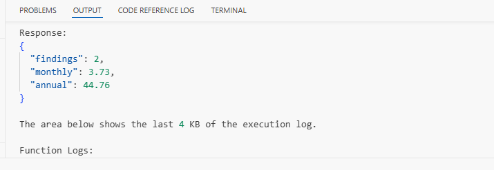 | 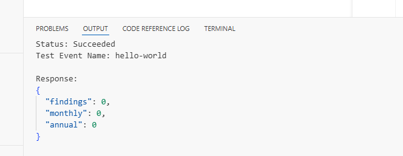 |

> The NAT gateway check is implemented but was not exercised in this lab, because a test gateway bills hourly. Validating it is on the roadmap below.

## Business case

Hourly NAT fees alone, at us-east-1 list price (illustrative, excludes data-processing charges):

| Idle NAT gateways | Wasted per year |
|---|---|
| 1 | $394.20 |
| 5 | $1,971.00 |
| 10 | $3,942.00 |
| 25 | $9,855.00 |

Assumption: a manual monthly audit takes about 2 hours at $60/hour, which is **$1,440/year** of staff time this replaces. These are modeled estimates, not measured savings.

## Security

- Least-privilege IAM policy: [`iam-policy.json`](iam-policy.json)
- Only `Describe*`, `GetMetricStatistics`, and one `sns:Publish` to a single topic
- No delete or modify permissions, so it is safe to run in any account
- No credentials or account IDs in the repo

## Design decisions

| Decision | Why |
|---|---|
| Lambda + EventBridge | Pay per run, nothing to patch, near-zero cost |
| Read-only permissions | The auditor can never cause an outage |
| CloudWatch traffic for NAT checks | Flags by evidence, not by guesswork |
| SNS email | Simplest delivery with no servers; Slack is a later swap |
| Built in the console first | Proves the fundamentals; Terraform is on the roadmap |

## Deploy

Click for setup steps (about 1 hour)

1. Create an SNS topic and confirm an email subscription.
2. Create the IAM policy from [`iam-policy.json`](iam-policy.json) with your topic ARN.
3. Create a Python Lambda, attach the policy to its role, and set the timeout to 1 minute.
4. Set environment variables `SNS_TOPIC_ARN` and `LOOKBACK_DAYS=7`.
5. Paste [`lambda_function.py`](lambda_function.py) and click Deploy.
6. Add an EventBridge schedule, for example `cron(0 13 ? * MON *)`.

## Build walkthrough

1. Guardrails and seeded waste

| Budget alarm ($5) | Unattached Elastic IP | Unattached EBS volume |
|---|---|---|
| 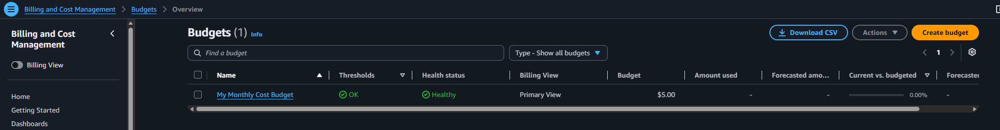 | 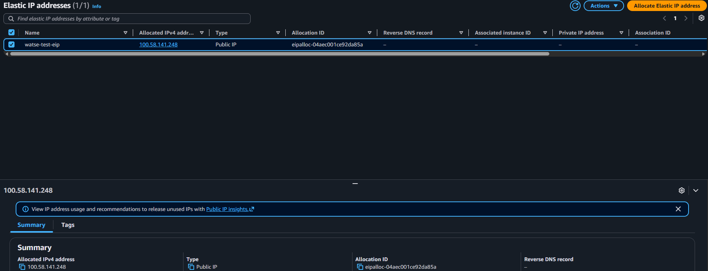 | 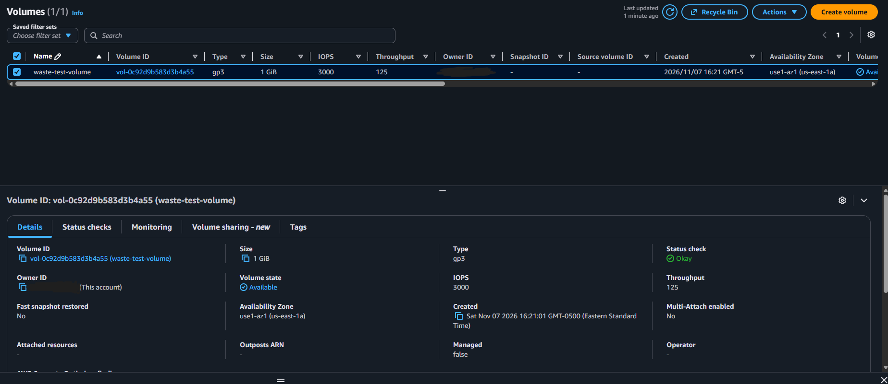 |

2. Alerts and least-privilege access

| SNS subscription confirmed | Read-only IAM policy (JSON) |
|---|---|
| 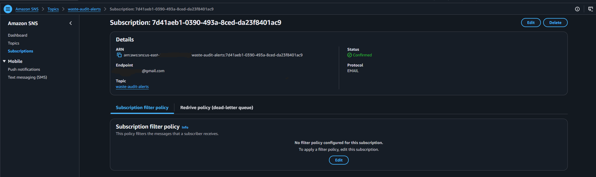 | 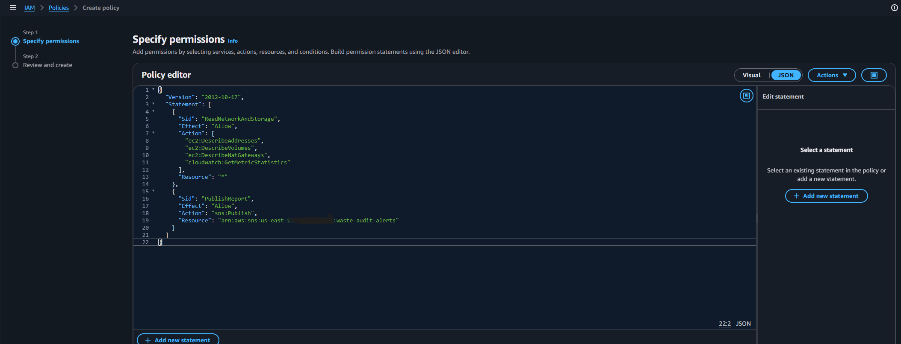 |

| Policy permissions summary | Policy attached to Lambda role |
|---|---|
| 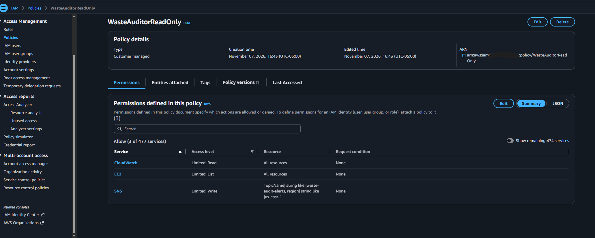 | 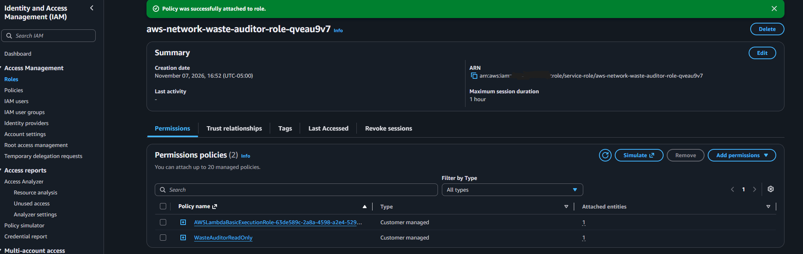 |

3. Function and weekly schedule

| Code deployed | Environment variables |
|---|---|
|  | 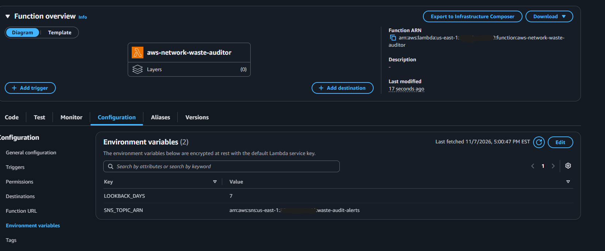 |

| EventBridge weekly schedule |
|---|
| 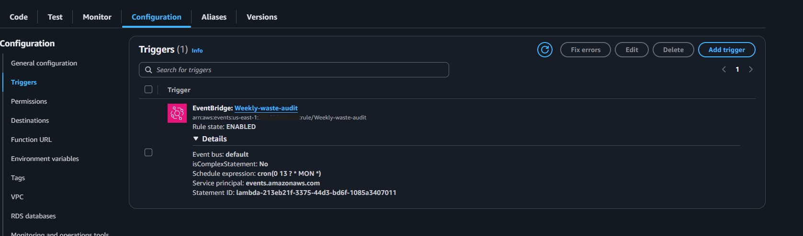 |

4. Cleanup

| Volumes removed |
|---|
| 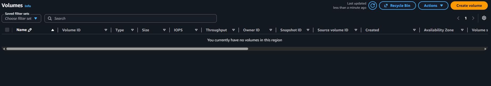 |

## Author

Built by **[Jesus Pujols](https://www.linkedin.com/in/jesus-pujols)**
